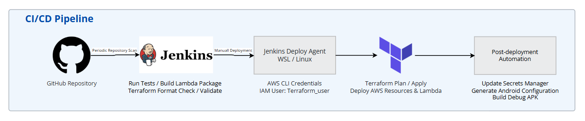

# Faretrack

1인 개발로 진행한 Kotlin 기반 항공권 가격 추적 서비스 프로젝트입니다.

AWS Lambda 기반으로 서버리스 배포 환경을 구축했습니다.


## 주요 기능

- Google 및 Kakao 소셜 로그인 기능
- 출발지와 도착지 공항 자동완성 기능
- 편도 및 왕복 항공편 검색
- 출발·귀국 시간과 직항 여부로 조건 검색 설정
- 가는 편과 오는 편 상세 정보 및 판매처 이동
- 목표 가격과 가격 하락률 기반 추적
- 최대 30일 가격 이력 그래프 확인 가능
- 목표 가격 도달 및 가격 하락 시 알림 푸시
- 동일 가격 중복 알림 방지

## 사용 기술

### App


### Infra


## 아키텍처

### 전체 구성


Android 앱에서 API Gateway로 요청을 전달하면 API Lambda가 항공편 검색과 가격 추적 등록 및 조회를 처리하도록 구성했습니다. 사용자 인증은 Cognito로 처리하고 항공권 가격 조회는 SerpAPI를 활용했으며 사용자의 추적 조건과 가격 이력, 알림 상태는 DynamoDB에 저장합니다.

가격 확인은 사용자 요청과 분리했습니다. EventBridge가 Scheduler Lambda를 실행하면 확인할 항목을 SQS에 등록하고 Price Worker가 현재 가격을 조회합니다. 알림 조건을 충족하면 별도의 Notification Lambda가 FCM으로 푸시 알림을 전송합니다.

또한 각 SQS에는 DLQ를 연결해 반복적으로 실패한 작업을 분리하도록 구성했습니다.

### CI/CD



**CI** - `main`에 코드를 push하거나 PR을 올리면 Jenkins가 변경 사항을 확인해 테스트와 Lambda 패키지 빌드를 실행합니다. Terraform 코드의 형식과 구성을 검사하고, 결과를 GitHub 커밋과 PR에 표시합니다.

**CD** - Jenkins에서 배포 작업을 수동으로 실행하면 Terraform으로 AWS 리소스와 Lambda 코드를 배포합니다. 이어서 SerpAPI 키와 Firebase 자격 증명을 Secrets Manager에 등록하고, 배포된 API와 Cognito 설정을 반영해 Android APK를 빌드합니다. Terraform state는 S3에 저장하며, 배포가 겹치지 않도록 설정했습니다.

### 소셜 로그인 및 API 요청 흐름


사용자가 Android 앱에서 Google 또는 Kakao 로그인을 선택하면 Cognito Hosted UI를 통해 로그인을 진행합니다. 로그인에 성공하면 Authorization Code를 전달받고 PKCE 방식으로 Access Token과 ID Token을 발급받습니다.

이후 앱은 Access Token을 Authorization 헤더에 담아 API Gateway로 요청을 보냅니다. JWT Authorizer를 통해 토큰을 검증하고 API Lambda로 요청을 전달합니다. API Lambda는 SerpAPI를 통해 항공편을 검색하고 DynamoDB에서 가격 추적 조건과 이력을 조회하거나 저장합니다. 사용자별 데이터는 JWT의 `sub` 값을 기준으로 구분해 다른 사용자의 데이터에 접근하지 못하도록 했습니다.

### 가격 추적 및 푸시 알림 흐름


**Scheduled Price Check**

EventBridge가 3시간 간격으로 Scheduler Lambda를 실행하면 활성화된 가격 추적 조건을 Price Check SQS에 등록합니다. Price Worker는 SQS의 메시지를 받아 SerpAPI에서 현재 가격을 조회하고 조회 결과와 가격 이력을 DynamoDB에 저장합니다.

외부 API 호출 횟수와 비용을 고려해 가격 확인 주기는 3시간으로 설정했습니다. 개발 환경은 비용 절감을 위해 `infra/terraform/environments/dev.tfvars`의 `price_tracking_enabled = false`로 예약 실행을 꺼두었으며, 자동 가격 추적이 필요할 때 활성화해 배포합니다.

**Evaluate Alert Conditions**

조회한 가격이 목표 가격 이하이거나 설정한 하락률을 충족하는지 확인합니다. 이전 알림 상태도 같이 확인해 동일한 가격에 대한 중복 알림을 방지하고 가격이 추가로 하락한 경우에는 다시 알림을 보내도록 했습니다. 알림이 필요한 경우 Notification SQS에 메시지를 등록합니다.

**Deliver Mobile Push Notification**

Notification Lambda는 DynamoDB에서 사용자의 FCM 기기 토큰을 조회하고 Secrets Manager에 저장된 Firebase 자격 증명을 이용해서 푸시 알림을 전송합니다. 알림 전송 결과는 DynamoDB에 저장하고 사용자가 알림을 누르면 앱의 `내 가격 추적` 화면으로 이동하도록 구성했습니다.

### 모니터링 및 비용 관리

**모니터링** - Lambda 실행 로그는 CloudWatch Logs에 저장하고 Lambda 오류와 API Gateway의 5xx 응답, SQS 메시지 지연 및 DLQ 적재 여부를 CloudWatch 경보로 확인하도록 설정했습니다. 경보가 발생하면 SNS를 통해 지정한 이메일 주소로 알림을 받습니다.

**비용 관리** - AWS Budgets의 개발 환경 월 예산은 10 USD로 설정하고 실제 비용이 예산의 80%와 100%에 도달하면 이메일 알림을 받도록 구성했습니다.

### 데이터와 보안

가격 추적 조건과 가격 이력, 알림 상태 및 기기 토큰은 DynamoDB에 저장합니다. 사용자별 데이터는 JWT의 사용자 ID를 기준으로 접근을 제한했습니다.

SerpAPI 키와 Firebase 자격 증명은 Secrets Manager에 저장하고, 각 Lambda에는 작업에 필요한 IAM 권한만 부여했습니다.

## 배포 및 실행 방법

### 1) Repository Clone

```bash
git clone https://github.com/lty02-ops/Faretrack.git
cd Faretrack
```

### 2) Jenkins와 배포 환경 준비

Jenkins에 CI용 `faretrack-ci` 노드와 배포용 `faretrack-deploy` 노드를 연결합니다. 배포 에이전트에는 AWS 인증, Node.js 22/npm, Terraform 1.15.8, Java 21 JDK와 Linux Android SDK를 준비합니다. 에이전트 프로세스가 실행 중이어야 작업이 진행됩니다.

GitHub 접근 자격 증명을 CI와 배포 작업에 연결하고, 배포용 OAuth 값·이메일·SerpAPI 키·Firebase 파일은 `faretrack-deploy` 폴더의 Credentials에 등록합니다. 필요한 ID와 파일 종류는 [배포 가이드](docs/deployment.md)를 참고합니다.

Jenkins는 `.env`를 읽지 않고 Credentials를 주입합니다. `.env`는 로컬 `infra/scripts/deploy-dev.sh`를 직접 실행할 때 사용하는 별도 설정입니다.

### 3) AWS 배포

최초 배포 전 Terraform state용 S3 버킷을 준비합니다. AWS 인증이 설정된 터미널에서 다음을 실행합니다. bootstrap state 파일은 로컬에 보관하고 Git에는 올리지 않습니다.

```bash
terraform -chdir=infra/bootstrap init
terraform -chdir=infra/bootstrap apply
```

Jenkins에서 **faretrack-deploy → faretrack-deploy-dev → Build Now**를 실행합니다. 이 작업은 실제 AWS 리소스를 생성하거나 변경하고, 앱 자격 증명 등록과 APK 빌드까지 진행합니다.

배포 후 Google·Kakao 개발자 콘솔에 아티팩트 `deployment-info.json`의 `socialProviderCallbackUrl`을 등록합니다. 동일한 URL이 이미 등록되어 있으면 유지합니다. SES 이메일 인증과 SNS 구독 확인 메일의 링크도 직접 확인합니다.

### 4) Android 앱 빌드 및 설치

성공한 Jenkins 빌드의 **Artifacts → app-debug.apk**를 다운로드해 기기에 설치할 수 있습니다.

Android Studio에서 직접 실행하려면 `D:\Lowest_airfare\android`처럼 로컬 저장소의 `android` 폴더를 엽니다. Firebase 콘솔에서 받은 `google-services.json`을 `android/app/`에 두고, Jenkins의 `deployment-info.json` 값을 로컬 `android/faretrack.local.properties`에 반영합니다. Jenkins에서 생성한 설정은 PC의 로컬 저장소에 자동 복사되지 않습니다.

```properties
faretrack.apiBaseUrl=<apiBaseUrl 값>
faretrack.cognitoClientId=<cognitoClientId 값>
faretrack.cognitoDomain=<cognitoDomain 값>
```

Android Studio에서 Run을 누르거나 PowerShell에서 다음을 실행합니다.

```powershell
cd android
.\gradlew.bat assembleDebug
adb install -r app/build/outputs/apk/debug/app-debug.apk
```

앱을 실행하고 Google 또는 Kakao로 로그인합니다.

### 5) 변경 사항 배포

코드 변경을 push하면 Jenkins가 스캔 주기에 따라 CI를 실행합니다. CI 결과를 확인한 뒤 **faretrack-deploy → faretrack-deploy-dev → Build Now**를 눌러 `main`을 배포합니다. CI 성공만으로 AWS 배포가 실행되지는 않습니다.

Jenkins가 최신 Android 설정과 APK를 다시 생성합니다. Android Studio로 실행한다면 최신 `deployment-info.json`을 기준으로 로컬 설정도 갱신합니다.

## Trouble Shooting

### 재배포 후 Cognito 로그인 실패

| &nbsp;구&#8288;분&nbsp; | 내용 |
|---|---|
| &nbsp;문&#8288;제&nbsp; | AWS 인프라를 다시 배포한 뒤 기존 APK에서 로그인 화면이 열리지 않았습니다. |
| &nbsp;원&#8288;인&nbsp; | 변경된 Cognito 도메인과 app client ID가 APK에 반영되지 않았습니다. |
| &nbsp;해&#8288;결&nbsp; | Jenkins가 Terraform output으로 연결 설정과 APK를 다시 생성합니다. Android Studio로 실행할 때는 최신 `deployment-info.json`을 로컬 설정에 반영하고 다시 빌드합니다. |

### 푸시 알림 미수신

| &nbsp;구&#8288;분&nbsp; | 내용 |
|---|---|
| &nbsp;문&#8288;제&nbsp; | 가격 알림 조건을 충족했지만 Android 앱에 푸시 알림이 도착하지 않았습니다. |
| &nbsp;원&#8288;인&nbsp; | Secrets Manager에 Firebase 자격 증명의 실제 값이 등록되지 않아 Notification Lambda가 FCM을 호출하지 못했습니다. |
| &nbsp;해&#8288;결&nbsp; | Jenkins 배포의 `Register application secrets` 단계에서 Firebase 서비스 계정과 SerpAPI 키를 Secrets Manager에 등록하도록 자동화했습니다. |

### 가격 알림 중복 전송

| &nbsp;구&#8288;분&nbsp; | 내용 |
|---|---|
| &nbsp;문&#8288;제&nbsp; | 주기적인 가격 확인 시 이미 보낸 알림이 반복해서 전송되었습니다. |
| &nbsp;원&#8288;인&nbsp; | 이전 알림 전송 여부와 가격을 기준으로 중복 알림을 구분할 필요가 있었습니다. |
| &nbsp;해&#8288;결&nbsp; | 알림 상태와 마지막 알림 가격을 DynamoDB에 저장해 최초 조건 도달 시 알림을 보내고, 이후 추가 하락 시 다시 알리도록 수정했습니다. |

## 배운 점

- **서버리스 구성:** API 요청과 주기적인 가격 확인을 Lambda와 SQS로 분리하고 실패한 작업을 재시도할 수 있는 구조를 이해할 수 있었습니다.

- **모바일 인증과 알림:** Cognito의 PKCE 인증 흐름과 FCM을 이용한 Android 푸시 알림을 연결하는 방법을 배울 수 있었습니다.

- **모니터링 구성:** CloudWatch로 Lambda 오류와 SQS 처리 지연을 감시하고 SNS로 이메일 알림을 보내는 방법을 배울 수 있었습니다.

## 아쉬운 점

- **외부 API 사용량 최적화:** 왕복 항공편과 판매처 정보를 조회할 때 여러 번의 API 요청이 필요했습니다. 검색 기능 구현에 집중했지만 요청 수를 줄이기 위한 캐시 정책과 조회 흐름을 더 효율적으로 설계하지 못했던 점이 아쉽습니다.

## 개발자

- GitHub: [lty02-ops](https://github.com/lty02-ops)
