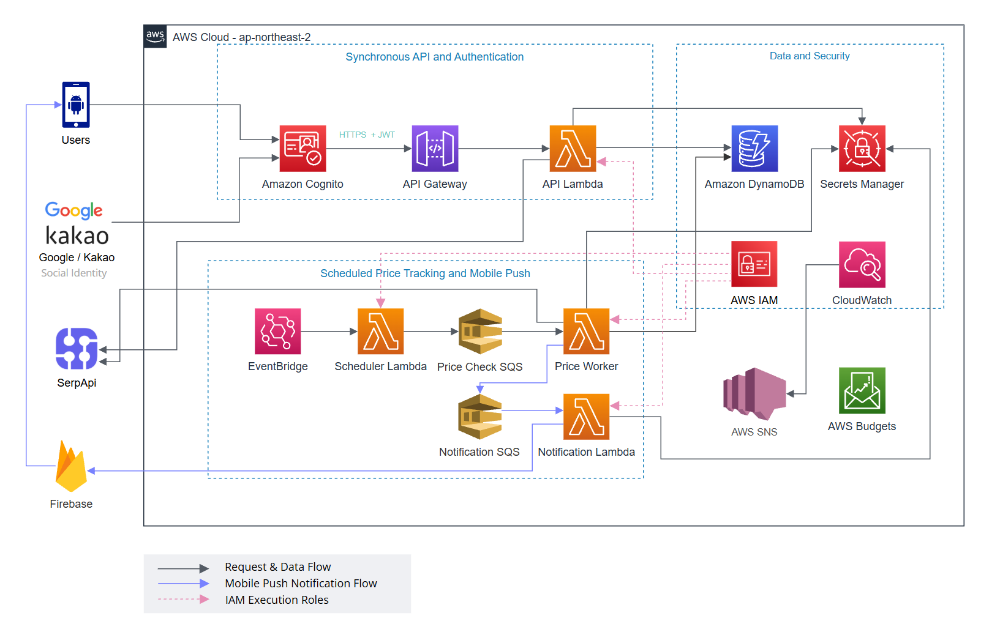
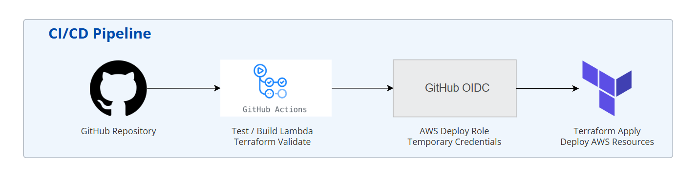

# Faretrack

항공권을 검색하고 목표 가격 또는 설정한 하락률에 도달했을 때 Android 푸시 알림을 보내는 가격 추적 서비스 애플리케이션입니다.

사용자는 Google 또는 Kakao 계정으로 로그인한 뒤 항공편을 검색하고 가격 추적을 등록할 수 있습니다. EventBridge가 활성화된 조건을 3시간 주기로 확인하며, 알림 조건을 만족하면 Firebase Cloud Messaging(FCM)으로 휴대폰 알림을 전송합니다.

## 기능

- Google 및 Kakao 소셜 로그인
- 출발지와 도착지 공항 자동완성
- 편도 및 왕복 항공편 검색
- 출발·귀국 시간과 직항 여부 조건 검색
- 가는 편과 오는 편 상세 정보 및 판매처 이동
- 목표 가격과 가격 하락률 기반 추적
- 최대 30일 가격 이력 그래프
- 중복 알림 억제 및 추가 하락 알림
- Firebase 기반 Android 푸시 알림
- Terraform 기반 AWS 인프라 관리
- GitHub Actions OIDC 기반 CI/CD
- CloudWatch 모니터링과 AWS Budgets 비용 경고

## 아키텍처

### 주요 구성



Faretrack은 별도의 EC2 서버나 VPC를 따로 두지 않는 관리형 **서버리스 아키텍쳐**로 설계하였습니다. Android 앱은 Amazon Cognito에서 발급받은 JWT로 API Gateway를 호출하고, API Lambda가 DynamoDB와 SerpApi를 이용해 항공편 검색, 가격 추적 등록, 가격 추이 조회 등을 처리합니다.

주기적인 가격 확인은 사용자 요청과 별도로 주기적으로 진행됩니다. EventBridge가 Scheduler Lambda를 실행하면 확인할 항목이 SQS에 등록되고, Price Worker가 순서대로 처리합니다. 이 구조 덕분에 SerpApi에 일시적인 오류나 지연이 발생해도 앱에서 저장된 알림과 가격 정보를 확인하거나 관리할 수 있습니다. 가격 확인에 실패한 작업은 SQS를 통해 자동으로 다시 시도합니다.

### 소셜 로그인과 API 인증


1. Android 앱에서 Google 또는 Kakao 로그인을 선택합니다.
2. Cognito가 선택한 서비스의 로그인 화면을 열어 사용자 인증을 진행합니다.
3. 로그인이 완료되면 authorization code(임시 코드)가 Android 앱으로 전달됩니다.
4. 앱은 인증 코드를 Cognito의 JWT 토큰으로 교환합니다. 이 과정은 PKCE로 보호됩니다.
5. 앱은 발급받은 JWT를 API 요청에 담아 전송합니다.
6. API Gateway가 JWT가 유효한지 확인합니다.
7. 인증된 요청만 API Lambda로 전달되며, Lambda에서는 JWT의 사용자 ID를 이용해서 자신의 데이터에만 접근하도록 제한합니다.

Android 앱에는 client secret과 같은 민감한 정보를 저장하지 않습니다. Google과 Kakao의 client secret은 Cognito 연동 설정에서 관리하며, SerpApi 키와 Firebase Admin 자격 증명은 Secrets Manager에 저장해 서버 측에서만 사용합니다.

### 가격 추적과 모바일 알림


1. EventBridge가 3시간 간격으로 Scheduler Lambda를 실행합니다.
2. Scheduler Lambda가 활성 추적 조건을 Price Check SQS에 넣습니다.
3. Price Worker가 SerpApi Google Flights에서 현재 가격을 조회합니다.
4. 조회 가격과 가격 이력을 DynamoDB에 저장합니다.
5. 목표 가격 도달, 최초 하락률 도달 또는 직전 알림 이후 추가 하락 여부를 평가합니다.
6. 알림이 필요하면 Notification SQS에 메시지를 발행합니다.
7. Notification Lambda가 SQS에서 알림 정보를 받고, DynamoDB에서 사용자의 기기 토큰을 조회합니다. 이후 Secrets Manager의 Firebase 자격 증명을 사용해 FCM 푸시 알림을 전송합니다.
8. 사용자가 알림을 누르면 Android 앱의 내 가격 추적 화면으로 이동합니다.

목표 가격 알림은 설정한 가격에 처음 도달했을 때 전송합니다. 하락률 알림은 설정한 하락률에 처음 도달했을 때 전송하며, 이후 가격이 직전 조회보다 더 내려가면 다시 알려줍니다. 알림 조건을 충족하지 않더라도 조회된 가격은 이력에 저장되며, 이를 그래프로 확인할 수 있습니다.

### 데이터와 보안

DynamoDB는 사용자별 추적 설정, 공통 검색 조건, 가격 이력, 알림 상태, FCM 기기 토큰을 저장합니다. 동일한 검색 조건을 여러 사용자가 추적하면 정규화된 검색 키를 공유하여 외부 API 호출을 줄입니다.

Secrets Manager에는 다음 런타임 비밀값을 저장합니다.

- `faretrack-dev/serpapi`: SerpApi API 키
- `faretrack-dev/firebase`: Firebase Admin 서비스 계정 JSON

각 Lambda 실행 역할은 필요한 DynamoDB 테이블, SQS 큐, secret에만 접근하도록 분리합니다. Terraform state, `.env`, Firebase JSON, Android 서명 키는 Git에 포함하지 않습니다.

### CI/CD



Pull Request를 생성하거나 `main` 브랜치에 코드를 push하면 CI workflow가 자동으로 실행됩니다. CI에서는 Node.js 의존성을 설치하고 테스트를 실행한 뒤, Lambda 배포 패키지가 정상적으로 생성되는지 확인합니다. 애플리케이션과 Bootstrap의 Terraform 코드에 대해서도 형식 검사와 구문 검증을 수행합니다.

개발 환경 배포는 GitHub Actions에서 `workflow_dispatch`를 통해 직접 실행합니다. 배포 전 테스트와 Lambda 패키지 빌드를 다시 진행하고, 통과하면 Terraform으로 변경 사항을 확인한 후 AWS 리소스에 적용합니다. 동시에 여러 배포가 실행되지 않도록 배포 workflow의 동시 실행도 제한합니다.

AWS 인증에는 GitHub OIDC를 사용합니다. GitHub Actions가 AWS 배포 역할을 인수해 작업 중에만 유효한 임시 자격 증명을 발급받으며, Terraform state는 S3에 저장해 관리합니다. 배포에 필요한 로그인 및 모니터링 설정값은 GitHub의 개발 환경 secret과 variable을 통해 전달합니다.

### 모니터링과 비용

각 Lambda의 실행 로그는 CloudWatch Logs에 저장합니다. Lambda에서 오류나 처리 제한이 발생하거나 API Gateway가 5xx 오류를 반환하면 CloudWatch 경보가 이를 감지합니다.

가격 확인 및 알림 메시지가 SQS에 15분 이상 머물거나, 반복적으로 실패한 작업이 DLQ에 들어간 경우에도 경보가 발생합니다. EventBridge의 Scheduler Lambda 호출 실패와 DynamoDB 요청 제한도 함께 감시합니다. 발생한 경보는 SNS를 통해 설정된 이메일 주소로 전달됩니다.

AWS Budgets를 이용해 월별 AWS 비용도 확인합니다. 개발 환경의 기본 예산은 월 10 USD으로 설정하였고, 실제 사용 비용이 예산의 80%와 100%를 넘으면 이메일 알림을 전송합니다.

## 사용 기술

### Application


- Android SDK 36, minimum SDK 26
- Kotlin, Java 17, AppAuth for Android
- Node.js Lambda handlers
- Firebase Cloud Messaging
- SerpApi Google Flights

### Infrastructure


- API Gateway, Cognito, Lambda, DynamoDB
- EventBridge, SQS 및 Dead Letter Queue
- Secrets Manager, CloudWatch, SNS, Budgets
- SES 이메일 fallback, S3 원격 Terraform state

## API

`/api/health`를 제외한 모든 API는 `Authorization: Bearer JWT` 헤더가 필요합니다.

| Method | Endpoint | 설명 |
|---|---|---|
| GET | `/api/health` | API 상태 확인 |
| POST | `/api/flights/search` | 항공편 검색 |
| POST | `/api/flights/return-options` | 가는 편에 연결되는 오는 편 조회 |
| POST | `/api/flights/booking-options` | 선택한 왕복 조합의 판매처 조회 |
| POST | `/api/devices` | FCM 기기 토큰 등록 |
| POST | `/api/alerts` | 가격 추적 등록 |
| GET | `/api/alerts` | 내 가격 추적 목록 조회 |
| PATCH | `/api/alerts/{id}` | 추적 조건 또는 상태 변경 |
| DELETE | `/api/alerts/{id}` | 가격 추적 삭제 |
| GET | `/api/history/{watchKey+}` | 가격 이력 조회 |
| POST | `/internal/price-check` | 인증된 수동 가격 확인 |

항공편 검색 요청 예시:

```json
{
  "origin": "ICN",
  "destination": "NRT",
  "departureDate": "2026-10-10",
  "returnDate": "2026-10-13",
  "tripType": "ROUND",
  "passengers": 1
}
```

## 로컬 실행

### Backend

```bash
cd /mnt/d/Lowest_airfare
npm install
npm test
npm start
```

로컬 서버의 기본 주소는 `http://localhost:3000`입니다. Android Emulator에서는 호스트 PC의 로컬 서버에 `http://10.0.2.2:3000`으로 접근합니다.

### Android

배포된 API와 Cognito 값은 `android/faretrack.local.properties`에 설정합니다. 자동 배포 스크립트는 Terraform output을 읽어 이 파일을 갱신합니다.

```powershell
cd D:\Lowest_airfare\android
.\gradlew.bat assembleDebug
```

APK는 `android/app/build/outputs/apk/debug/app-debug.apk`에 생성됩니다.

## AWS 배포

### 로컬 배포

#### 1. Bootstrap

최초 한 번 원격 state용 S3 버킷과 GitHub OIDC 배포 역할을 생성합니다.

```bash
cd /mnt/d/Lowest_airfare/infra/bootstrap
terraform init
terraform plan
terraform apply
terraform output
```

출력된 `github_deploy_role_arn`을 GitHub Repository Variable `AWS_DEPLOY_ROLE_ARN`으로 등록합니다.

#### 2. 환경 변수

루트의 `.env.example`을 참고해 Git에 포함되지 않는 `.env`를 작성합니다.

```dotenv
TF_VAR_google_client_id=google-web-client-id
TF_VAR_google_client_secret=google-client-secret
TF_VAR_kakao_client_id=kakao-rest-api-key
TF_VAR_kakao_client_secret=kakao-client-secret
SERPAPI_API_KEY=serpapi-key
FIREBASE_SERVICE_ACCOUNT_FILE=/path/to/firebase-adminsdk.json
```

#### 3. 애플리케이션 배포

다음 스크립트가 환경 변수 로드, Lambda ZIP 생성, Terraform 적용, SerpApi/Firebase secret 등록, Android 설정 생성을 순서대로 처리합니다.

```bash
cd /mnt/d/Lowest_airfare
bash infra/scripts/deploy-dev.sh
```

백엔드 코드나 Terraform 설정을 변경한 경우에도 같은 스크립트를 다시 실행하면 변경된 항목만 반영됩니다.

최초 배포가 끝나면 생성된 `android/faretrack.local.properties`를 포함해 APK를 빌드하고 설치합니다. Google과 Kakao 개발자 콘솔에는 Terraform output에서 나온 `social_provider_callback_url`을 callback URI로 등록합니다.

#### 4. 배포 확인

```bash
cd /mnt/d/Lowest_airfare/infra/terraform
terraform output
curl "$(terraform output -raw api_base_url)/api/health"
```

### GitHub Actions 배포

GitHub Actions에서 개발 환경 배포 workflow를 수동으로 실행할 수 있습니다. GitHub Actions는 Terraform을 이용한 AWS 리소스 배포를 담당하며, SerpApi 키와 Firebase 자격 증명 등록은 로컬 deploy-dev.sh를 통해 별도로 진행합니다.

## Troubleshooting

### 재배포 후 Cognito 로그인 실패

AWS 인프라를 다시 배포한 뒤 Cognito 도메인과 app client ID가 변경되면서, 기존 값이 들어 있던 APK에서 로그인 화면이 열리지 않는 문제가 발생했습니다. 배포 스크립트가 Terraform output을 `android/faretrack.local.properties`에 자동으로 반영하도록 수정하고 APK를 다시 빌드해 해결했습니다.

### 푸시 알림이 전송되지 않는 문제

가격 알림 조건을 충족했지만 Android 앱에 푸시 알림이 도착하지 않았습니다. 확인 결과 Secrets Manager에 Firebase 자격 증명의 실제 값이 등록되지 않아 Notification Lambda가 FCM을 호출하지 못하고 있었습니다. 배포 과정에서 deploy-dev.sh가 Firebase 자격 증명을 Secrets Manager에 등록하도록 수정해 해결했습니다.

### 가격 알림이 반복해서 전송되는 문제

가격을 주기적으로 확인할 때 이미 보낸 알림이 반복해서 전송되는 문제가 있었습니다. 알림 전송 여부와 마지막 알림 가격을 DynamoDB에 저장해, 목표 가격이나 설정한 하락률에 처음 도달했을 때만 알림을 보내도록 수정했습니다. 이후 가격이 더 내려간 경우에는 새로운 알림을 전송합니다.

## 현재 제약 사항

## 현재 제약 사항

- 항공편 검색 결과는 SerpApi Google Flights 데이터에 의존하므로 네이버 항공권 등 다른 서비스와 결과 수, 가격 및 판매처가 다를 수 있습니다.
- 왕복 항공편과 판매처를 조회할 때 여러 번의 SerpApi 요청이 발생할 수 있어 요금제의 API 사용량에 따라 검색 횟수가 제한됩니다.
- 최근 30일 가격 그래프는 SerpApi가 제공하는 과거 데이터와 Faretrack이 수집한 이력을 사용합니다. 수집된 이력이 부족하면 일부 기간의 가격이 표시되지 않을 수 있습니다.
- 이메일 대체 알림은 Google 로그인 사용자에게만 제한적으로 제공됩니다. 현재 Kakao 로그인에서는 이메일 정보를 가져오지 않으며, SES 샌드박스 환경에서는 Google 사용자도 AWS에서 별도로 인증한 이메일 주소로만 알림을 받을 수 있습니다.
